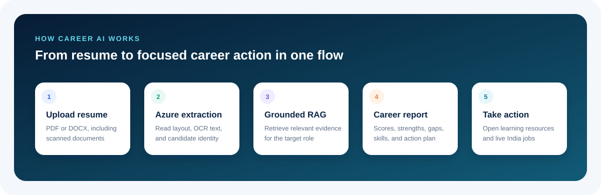
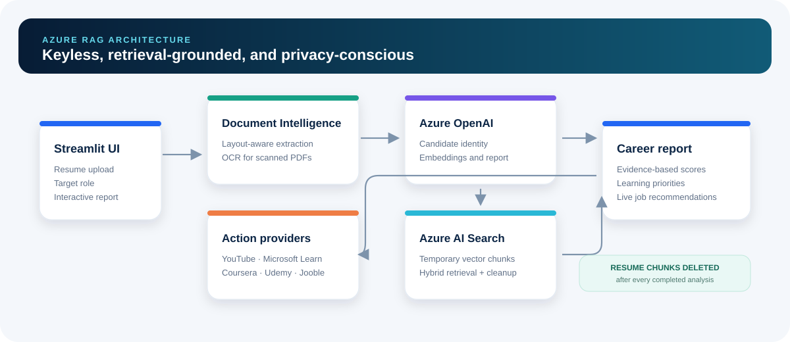

# Career AI

[](https://github.com/beyondmarks-ai/Career-AI/actions/workflows/ci.yml)

Career AI turns a resume into a grounded career report, focused learning plan, and
live job shortlist. It combines Azure Document Intelligence, Azure OpenAI, Azure AI
Search RAG, Jooble, and a professional Streamlit interface.



## What it delivers

- Layout-aware PDF and DOCX extraction, including OCR for scanned PDFs
- Personalized welcome using the candidate name found in the resume
- Resume quality, ATS readiness, and target-role match scores
- Evidence-based strengths and specific improvement recommendations
- Missing role keywords with free and paid learning links
- Prioritized skills and measurable next steps
- Live Jooble recommendations for the target role across India
- English, Hindi, and French report options
- Keyless local authentication through Azure CLI
- Managed Identity support for Azure App Service
- Temporary vector indexing with automatic resume-chunk deletion

The prompts treat resume content as untrusted data and require every observation to
be supported by evidence found in the resume.

## How it works

1. The user uploads a PDF or DOCX resume and enters a target role.
2. Azure Document Intelligence extracts text, layout, and OCR content.
3. Azure OpenAI identifies the candidate and creates embeddings.
4. Azure AI Search temporarily indexes resume chunks and retrieves the sections most
   relevant to the target role.
5. Azure OpenAI generates a structured, retrieval-grounded report.
6. The temporary search documents are deleted.
7. The interface presents learning resources and current Jooble jobs in India.



## Technology

| Layer | Service or library |
|---|---|
| Interface | Streamlit |
| Document extraction | Azure Document Intelligence |
| Chat and structured output | Azure OpenAI |
| Embeddings | Azure OpenAI embeddings |
| Retrieval | Azure AI Search hybrid vector search |
| Job recommendations | Jooble REST API |
| Learning links | YouTube, Microsoft Learn, Coursera, and Udemy |
| Authentication | Azure CLI locally; Managed Identity on Azure |

## Prerequisites

- Python 3.11 or newer
- Git
- Azure CLI
- An Azure subscription containing:
  - Azure OpenAI chat and embedding deployments
  - Azure Document Intelligence or a compatible Azure AI multi-service resource
  - Azure AI Search
- A Jooble API key

## Quick start

Clone this repository:

```bash
git clone https://github.com/beyondmarks-ai/Career-AI.git
cd Career-AI
```

Create a virtual environment.

Windows:

```powershell
python -m venv .venv
.\.venv\Scripts\python.exe -m pip install --upgrade pip
.\.venv\Scripts\python.exe -m pip install -r requirements-streamlit.txt
```

macOS or Linux:

```bash
python3 -m venv .venv
.venv/bin/python -m pip install --upgrade pip
.venv/bin/python -m pip install -r requirements-streamlit.txt
```

Sign in to Azure:

```bash
az login
```

Create the private local configuration:

Windows:

```powershell
Copy-Item .env.example .env
```

macOS or Linux:

```bash
cp .env.example .env
```

Update `.env` with your resource values:

```env
AZURE_OPENAI_ENDPOINT=https://YOUR-OPENAI-RESOURCE.openai.azure.com/
AZURE_OPENAI_DEPLOYMENT=YOUR-CHAT-DEPLOYMENT
AZURE_OPENAI_EMBEDDING_DEPLOYMENT=YOUR-EMBEDDING-DEPLOYMENT
AZURE_OPENAI_API_VERSION=2024-10-21
AZURE_OPENAI_API_KEY=YOUR-AZURE-OPENAI-API-KEY
AZURE_DOCUMENT_INTELLIGENCE_ENDPOINT=https://YOUR-AI-RESOURCE.cognitiveservices.azure.com/
AZURE_DOCUMENT_INTELLIGENCE_API_KEY=YOUR-DOCUMENT-INTELLIGENCE-API-KEY
AZURE_SEARCH_ENDPOINT=https://YOUR-SEARCH-SERVICE.search.windows.net
AZURE_SEARCH_INDEX=career-ai-resumes
AZURE_SEARCH_API_KEY=YOUR-AZURE-SEARCH-ADMIN-KEY
JOOBLE_API_KEY=YOUR-JOOBLE-API-KEY
```

Never commit `.env`. The repository excludes it through `.gitignore`.
When the API-key variables are omitted, the app falls back to Azure CLI or Managed
Identity authentication through `DefaultAzureCredential`.

To retrieve keys from the Azure resources already configured for this repository,
authenticate once and run:

```powershell
az login
.\configure-api-keys.ps1
```

The running application then uses the keys in `.env` and does not require Azure CLI.
Treat `.env` as a secret because the Search admin key and cognitive-service keys grant
access to billable resources.

## Required Azure roles for passwordless authentication

The local Azure CLI identity needs:

- **Cognitive Services OpenAI User** on the Azure OpenAI resource
- **Cognitive Services User** on the Document Intelligence resource
- **Search Service Contributor** when creating the search index
- **Search Index Data Contributor** on the `career-ai-resumes` index

For least privilege, scope **Search Index Data Contributor** to the individual index
instead of the entire Search service.

## Run the application

Windows:

```powershell
.\.venv\Scripts\python.exe -m streamlit run main.py
```

macOS or Linux:

```bash
.venv/bin/python -m streamlit run main.py
```

Open [http://localhost:8501](http://localhost:8501), then:

1. Upload a resume of up to 8 MB.
2. Enter the target role.
3. Select the report language.
4. Click **Create my career report**.
5. Review the scores and resume insights.
6. Open missing skills to find learning resources.
7. Select **Jobs in India**, then click **Find matching jobs**.

## Tests

Windows:

```powershell
.\.venv\Scripts\python.exe -m unittest discover -s tests -v
```

macOS or Linux:

```bash
.venv/bin/python -m unittest discover -s tests -v
```

The tests cover document parsing, schema validation, resume chunking, safe learning
links, Jooble request construction, response sanitization, and unsafe-link rejection.

## Azure App Service deployment

The deployment script publishes the application to Linux App Service, configures the
runtime and environment, enables Managed Identity, and applies the supplied resource
roles.

```powershell
.\deploy-azure.ps1 `
  -AppName 'YOUR-GLOBALLY-UNIQUE-APP-NAME' `
  -AzureOpenAIEndpoint 'https://YOUR-OPENAI-RESOURCE.openai.azure.com/' `
  -AzureOpenAIDeployment 'YOUR-CHAT-DEPLOYMENT' `
  -AzureOpenAIEmbeddingDeployment 'YOUR-EMBEDDING-DEPLOYMENT' `
  -AzureOpenAIResourceId '/subscriptions/.../providers/Microsoft.CognitiveServices/accounts/YOUR-OPENAI-RESOURCE' `
  -DocumentIntelligenceEndpoint 'https://YOUR-AI-RESOURCE.cognitiveservices.azure.com/' `
  -DocumentIntelligenceResourceId '/subscriptions/.../providers/Microsoft.CognitiveServices/accounts/YOUR-AI-RESOURCE' `
  -AzureSearchEndpoint 'https://YOUR-SEARCH-SERVICE.search.windows.net' `
  -AzureSearchResourceId '/subscriptions/.../providers/Microsoft.Search/searchServices/YOUR-SEARCH-SERVICE' `
  -JoobleApiKey 'YOUR-JOOBLE-API-KEY'
```

The default App Service tier is B1 and can create billable Azure resources.

## Vercel deployment

Vercel serves `app.py` as a Flask Function. The Streamlit interface remains available
for local and container deployments, while the Vercel interface uses the same Azure
analysis and job-service modules.

Install the Vercel CLI, link the project, add the variables from `.env` through the
Vercel dashboard, and deploy:

```bash
npx vercel link --project career-ai
npx vercel --prod
```

Configure every variable listed in the example environment file for the Production
environment. Vercel deployments limit resume uploads to 4 MB; local Streamlit and
Azure App Service deployments retain the 8 MB limit.

## Project structure

```text
main.py                       Streamlit interface and report presentation
analysis_service.py           Candidate identity and grounded report generation
azure_document_service.py     Azure PDF, DOCX, layout, and OCR extraction
rag_service.py                Temporary Azure AI Search vector retrieval
job_service.py                Jooble job search for target roles in India
learning_resources.py         Safe free and paid course search links
llm_helper.py                 Azure CLI and Managed Identity authentication
resume_parser.py              Local parser used by automated tests
deploy-azure.ps1              Azure App Service deployment automation
.streamlit/config.toml        Theme and upload-size configuration
docs/images/                  README workflow and architecture diagrams
tests/test_core.py            Unit tests
```

## Privacy and security

- Uploaded files are not written to local or Azure Blob storage.
- Extracted resume chunks are temporarily stored in the configured Azure AI Search
  index and deleted after each analysis.
- External URLs are validated before being rendered.
- Provider search links are generated deterministically instead of trusting
  AI-generated URLs.
- API keys belong only in `.env` or a managed application setting.
- Production deployments should add an organizational privacy notice, monitoring,
  rate limiting, and a documented retention policy.

## Troubleshooting

### Azure authentication fails

Run `az login`, confirm the active subscription with `az account show`, and verify the
required resource roles.

### Azure AI Search returns 403

Grant the calling identity **Search Index Data Contributor** on
`career-ai-resumes`. Creating the index also requires **Search Service Contributor**.

### Very little resume text is extracted

Upload a clearer PDF or DOCX. Azure Document Intelligence supports OCR, but image
quality, encryption, or corruption can still prevent extraction.

### Jobs are not displayed

Confirm `JOOBLE_API_KEY` is set, then use a recognizable target-role title. Jooble
results are cached for 15 minutes to avoid unnecessary API usage.
